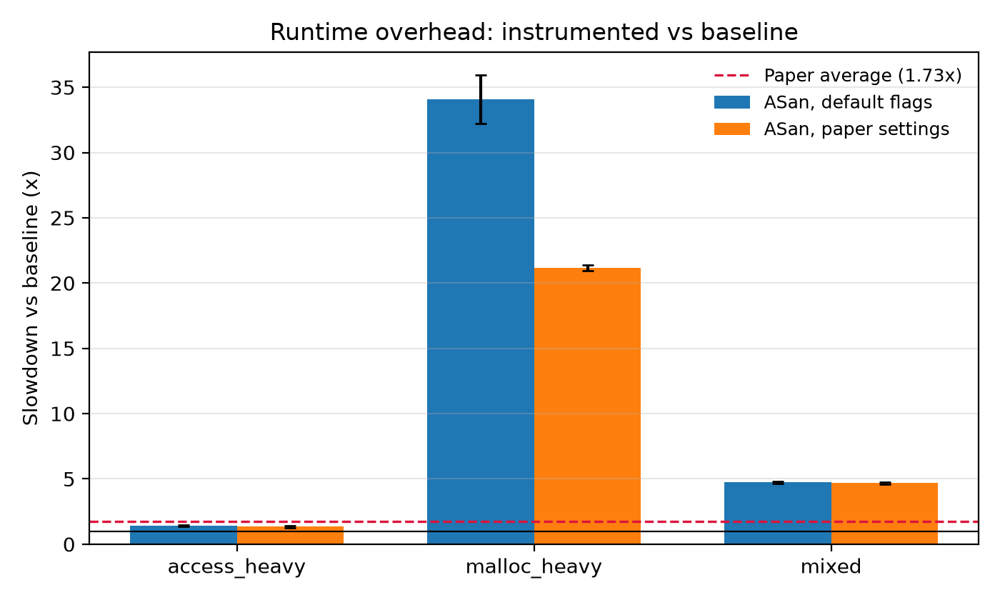
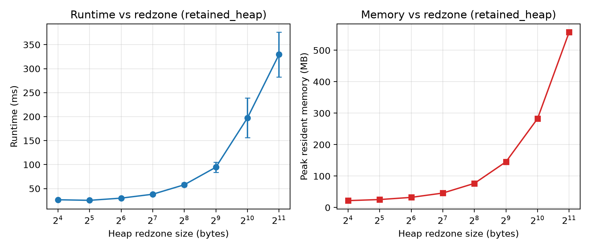

# Reproduction of *AddressSanitizer: A Fast Address Sanity Checker*

> Paper: Konstantin Serebryany, Derek Bruening, Alexander Potapenko, Dmitry Vyukov.
> *AddressSanitizer: A Fast Address Sanity Checker.* USENIX ATC 2012.
> Course: CS340 Operating Systems, Academic Year 2026–2027.
> Repository: `llx1626327139-cell/CS340-ASan-Reproduction`; the final submission is
> tagged `v1.0`.
> Every number in this report can be traced to a file under `docs/measured/`; the map
> is Table 12.

## Group and contribution

| Member | Student ID | Contribution |
| --- | --- | --- |
| 陈禹诚 | 1240001636 | detection cases (C1), CI pipeline, benchmark harness |
| 赖泊霖 | 1240012602 | paper analysis, claim mapping, baseline measurements |
| 徐梁杰 | 1240014650 | extension (redzone sweep), memory profiling (C2, C3), C2 K-sweep & C6 control |
| 刘蓝希 | 1240014492 | local reproduction (C2, C3, C1), draft report, consistency check |

## AI usage statement

We used an AI assistant to help structure the report, to draft English prose from
measured results, and to debug the WSL2 and container toolchain setup. All numerical
data were produced by the scripts in this repository and re-derived from the raw TSV
files when this report was written; no experimental value was generated or filled in
by AI.

---

## 1. Introduction and Claims

### 1.1 Paper and problem

Memory access bugs — buffer overflows and uses of freed heap memory — remain a
serious correctness and security problem for C and C++. The detectors available in
2012 either slowed a program down by an order of magnitude (Valgrind, Dr. Memory) or
covered only part of the address space (heap only), or both. AddressSanitizer (ASan)
proposes to break that trade-off with three cooperating layers: a **compact shadow
memory** that records one byte of state per eight bytes of application memory, a
**compile-time instrumentation pass** that checks that byte before every load and
store, and a **replacement allocator plus runtime interceptors** that poison redzones
around every object, delay the reuse of freed memory in a quarantine, and record
allocation and free stacks.

The paper's quantitative claims are a **73% average slowdown (1.73x)** on SPEC
CPU2006, a **3.37x average memory footprint** (3.4x in the abstract, 3.37x in §4 and in
the total row of Table 1), detection of out-of-bounds accesses on
the **heap, stack and globals** plus **use-after-free** with **no false positives**,
and reporting at the point of occurrence. We test the first, second and the detection
claim; the stack-footprint and binary-size figures of section 4 are reported as
secondary checks, and the quarantine parameter is examined as a mechanism control.

### 1.2 Claims tested

**Table 1. The three claims under test and where each comes from in the paper.** Each
claim is tied to the table or figure it comes from, and the last two columns record
how it is tested and what came out.

| ID | Claim as stated in the paper | Paper anchor | Paper value | How it is tested here | Headline result |
| --- | --- | --- | --- | --- | --- |
| C1 | ASan detects out-of-bounds accesses on the heap, stack and globals, and uses of freed heap memory, and reports them at the point of occurrence without false positives | §3.4 (stack and globals), §3.5 (false negatives), §3.6 (false positives), §4.2 (300+ bugs in Chromium) | report classes demonstrated for heap, stack, globals and use-after-free; "AddressSanitizer has no false positives" (§3.6); 300+ previously unknown bugs found (§4.2) | seven minimal C programs, one per class, run under the shipped runtime; the verdict class of each report is compared with the expectation | 7 / 7 classes reported, correct class, at the faulting instruction |
| C2 | Instrumented code runs at 1.73x the baseline on average | **Figure 2** | 1.73x average over the C/C++ benchmarks of SPEC CPU2006 (19 programs; worst: perlbench 2.60x, xalancbmk 2.67x); writes-only variant 1.26x | three workloads × {baseline, ASan} × five runs, plus a 6-point K-access sweep per allocation | 1.35x / 4.68x / 21.18x across workloads; K-sweep converges from 3.59x (`K=1`) to 1.40x (`K=1024`) |
| C3 | Memory footprint grows to 3.37x on average | **Table 1** | 3.37x average as stated by the paper (Table 1 total row; per-benchmark 1.40x–24.55x, povray 24.55x) | same runs, peak resident memory (`VmHWM`) | 3.66x / 1.46x / 1.86x per workload; 2.33x across the three |

Two further quantities from the paper are checked as **secondary observations** in
§3.4 rather than as tested claims, because our workloads cannot exercise their
regime: stack footprint (**Table 2** of the paper) and binary size (§4, 1.5x–3.2x,
2.5x average). One **mechanism control** is reported in §3.5: the quarantine
parameter of the paper's §3.5 and §4.3, verified with a free-then-reallocate control
program.

### 1.3 Scope of the reproduction

Reproduced, at reduced scale:

- **detection**: seven error classes, one hand-written program each, on one machine,
  with the committed raw reports, plus a free-then-reallocate quarantine control (`08_free_realloc.c`);
- **cost**: three workloads × three build/option configurations × five runs, plus
  a six-point access-density sweep (`kaccess`) and binary size / stack footprint checks;
- **extension**: an eight-point sweep of the heap redzone size × three runs.

Not reproduced, and treated as a deviation rather than a gap to be filled:

- the C/C++ benchmarks of SPEC CPU2006 (19 programs; commercial licence, withdrawn
  from the SPEC site);
- the authors' 2011 LLVM branch as a build target;
- the Chromium-scale bug corpus of §4.2 (300+ bugs over ten months);
- the Valgrind / Dr. Memory comparison of §4.1;
- the proposed hardware `checkN` instruction of §5.3.

---

## 2. Reproduction Setup

### 2.1 Starting code, commits and modified files

The paper's artifact is an ASan build inside an LLVM branch from 2011, which no
longer compiles. We therefore exercise the runtime that ships today and identify it
precisely, so that the exact library can be re-checked on any machine:

- **Tool under test** — `libasan` shipped with GCC 15.2.0,
  `/usr/lib/gcc/x86_64-linux-gnu/15/libasan.so`, the GCC port of LLVM `compiler-rt`
  (supplemented by Apple Clang `libclang_rt.asan_osx_dynamic.dylib` for the `kaccess`
  sweep and `08_free_realloc` control runs).
- **Upstream project** — LLVM `compiler-rt` (Apache-2.0 WITH LLVM-exception); credited,
  not vendored.
- **Implementation rebuilt from source?** — no; the shipped runtime is consumed as a
  black box.
- **Upstream source files modified** — none.
- **Files added by us** — test programs, harness, scripts, CI and documentation, listed
  one by one in the repository `README`, §8.
- **Commit of the cost measurements and the extension** — `eb67bb3`.
- **Commit of the committed detection logs** — `6a7e845`.
- **Commits of the C6 quarantine control and C2 K-access sweep** — `24f59e4` and `a089318`.
- **Released version** — tag `v1.0`.

Multiple commits appear because the detection logs were captured in CI before the
benchmark harness, extension, and controlled follow-up experiments were added; each
artifact states which commit produced it, and all are ancestors of `v1.0`. For a
"reproduction of a tool" the starting code is the runtime itself, so its provenance is
recorded as the library path above rather than as a source commit.

### 2.2 Environment

Two primary environments were used for the main suite, plus an Apple Silicon macOS
environment for the follow-up controlled experiments (`kaccess` and `08_free_realloc`),
and every artifact names the one that produced it.

**Table 2. Environments actually used, and which artifacts each produced.**

| | A. Detection suite | B. Cost measurements and extension |
| --- | --- | --- |
| Machine | GitHub Actions runner | local workstation (plus Apple Silicon MacBook Air for `kaccess` & C6 follow-ups) |
| CPU | AMD EPYC 9V45 96-Core, 4 vCPU (2 cores × 2 threads), 15.6 GB RAM | Intel Core i7-14650HX (and Apple arm64 for follow-ups) |
| OS / kernel | Ubuntu 26.04.1 LTS / `7.0.0-1019-azure` | Ubuntu on WSL2 / `6.18.58.1-microsoft-standard-WSL2` (macOS for follow-ups) |
| Compiler | gcc 15.2.0; clang 21.1.8 for case 07 | gcc 15.2.0 (Apple Clang `-O2` for `kaccess`) |
| Build flags | `-std=c11 -g -O1 -fno-omit-frame-pointer -Wall -Wextra -fsanitize=address -fno-common` | `-std=c11 -O2 -g -fno-omit-frame-pointer` (+ `-fsanitize=address`) |
| Runtime flags | `symbolize=1:abort_on_error=0:detect_leaks=1`; case 07 adds `detect_stack_use_after_return=1` | `asan_paper` = `quarantine_size_mb=0:redzone=32:malloc_context_size=0`; `asan_default` = tool defaults (quarantine 256 MB, redzone 128 B) |
| Commit | `6a7e845` | `eb67bb3` (`24f59e4` / `a089318` for C6 & `kaccess`) |
| Evidence | `docs/measured/environment.md`, `docs/measured/logs/` | headers of `docs/measured/performance.md`, `extension.md`, `kaccess.md`, `exp_quarantine.md` |

The environments are deliberately kept apart instead of being conflated: the
detection suite needs seven processes and no timing, so it runs in CI, while the cost
measurements need a quiet machine and a fixed reference. Timing is taken inside the
process with `clock_gettime(CLOCK_MONOTONIC)`, so process start-up is excluded; memory
figures are read from `/proc/self/status` at exit. Only intra-run ratios between the
baseline and the ASan build on the **same machine and compiler** are used, never
absolute milliseconds across runs or machines.

### 2.3 Workloads

All workloads are written by us in `bench/bench.c`; nothing is downloaded. Each
run prints one machine-readable line, `RESULT mode=… time_ms=… vmhwm_kb=… vmstk_kb=… checksum=…`,
and the checksum exists so that two builds can be shown to have performed the same
work. Table 3 summarises the workloads.

**Table 3. Workloads and the regime each represents.**

| Workload | Pattern | Size of the work | Regime |
| --- | --- | --- | --- |
| `malloc_heavy` | malloc → write first and last byte → free, 8–71 B objects | 5,000,000 iterations | allocation-dominated (the paper's perlbench / xalancbmk end) |
| `access_heavy` | random read-modify-write of single bytes in an 8 MB buffer | 60,000,000 accesses | access-dominated; worst case for the shadow check |
| `mixed` | 100 sequential sweeps of a 16 MB buffer plus one 4 KB allocation per sweep | 400,000,000 accesses | compute-bound (the paper's average case) |
| `retained_heap` | 200,000 live 48-byte objects, each touched once | 9.2 MB live set | used by the redzone extension: redzone occupancy has to accumulate |
| `kaccess` | 100,000 objects (10 batches × 10,000 live 48 B objects), `K` byte accesses per object (`K` = 1…1024) | 100,000 allocations, `10⁵·K` accesses | sweeps continuously from allocation-dominated (`K=1`) to compute/access-bound (`K=1024`) |

### 2.4 Deviations from the paper

Table 4 lists every change from the paper's setup, with the original setting, the
setting used and the reason. Rows 1–3 are structural (benchmarks, compiler, machine);
rows 4–8 are settings that change the measured number and therefore had to be
reproduced as well as recorded; rows 9–13 are parts of the paper that this scale of
reproduction cannot reach.

**Table 4. Every change from the paper's setup: item, original setting, setting used, reason.**

| # | Item | Original setting in the paper | Setting used here | Reason |
| --- | --- | --- | --- | --- |
| 1 | Benchmark suite | all C/C++ programs of SPEC CPU2006 (19 benchmarks) | three hand-written microbenchmarks plus `retained_heap` and `kaccess` | CPU2006 requires a commercial licence and has been withdrawn from the SPEC site; microbenchmarks let us place the two extremes (allocation-bound, access-bound) deliberately |
| 2 | Compiler / implementation | authors' 2011 LLVM branch, Clang `-O2` | gcc 15.2.0 `libasan`; clang 21.1.8 only for case 07 (Apple Clang for `kaccess`) | the 2011 branch no longer builds; the shipped runtime is its only buildable descendant |
| 3 | Hardware | HP Z600, 2 × 4-core Xeon E5620, 24 GB, bare metal | 4 vCPU cloud VM (detection); i7-14650HX on WSL2 (cost); Apple arm64 (`kaccess`) | no bare metal available; ratios are therefore taken within a single run on the same machine |
| 4 | Heap redzone for the cost measurement | 32 B | 32 B (`asan_paper`), with the tool default 128 B as a second configuration | the paper's setting is needed for comparability; the default is what a user gets today and shows the quarantine's share of the cost |
| 5 | Quarantine | 0 for the cost measurement; 256 MB default when hunting bugs | both measured (`asan_paper` = 0, `asan_default` = 256 MB) | the paper uses two settings in two places; measuring one only makes the allocation-bound ratio differ by an order of magnitude |
| 6 | malloc/free stack unwinding | disabled ("disabled the stack unwinding") | disabled in `asan_paper` (`malloc_context_size=0`), enabled at the default depth 30 in `asan_default` | same reason as row 5: this is a setting that changes the result and has to be recorded |
| 7 | Memory metric | `VmPeak` from `/proc/self/status` | `VmHWM`, with `VmPeak` also recorded | the shadow is a `MAP_NORESERVE` reservation, so `VmPeak` reads ≈ 20.5 TB here and no ratio can be formed from it |
| 8 | Repetition count | not stated | 5 runs per configuration (cost), 3 runs per point (extension and `kaccess`) | CI and OS jitter is visible in single measurements; mean ± standard deviation is reported instead of a single sample |
| 9 | Detection corpus | 3 real bugs in CPU2006; 300+ bugs in Chromium | seven designed minimal cases plus `08_free_realloc.c` | no corpus of comparable scale is obtainable; designed cases let us assert the expected class exactly |
| 10 | Comparison with Valgrind / Dr. Memory | 20x / 10x slowdown measured and compared | not measured | neither tool is installed, and their detection sets differ from ASan's, so comparing wall-clock alone would mislead |
| 11 | `stack-use-after-return` | not covered (no fake stack in 2012) | added as case 07; needs clang and `detect_stack_use_after_return=1` | a later evolution of the tool; GCC still has no fake stack, so this one case is pinned to clang |
| 12 | Deep-stack workloads for the stack-footprint claim | SPEC programs with deep call chains | none; all workloads have shallow stacks | a microbenchmark with no recursion cannot move `VmStk`; the stack check is therefore reported as partial |
| 13 | Implementation built from source | the paper's own build | shipped runtime, no rebuild | the point of the reproduction is the behaviour of the mechanism, and a 2011 branch cannot be built on a 2026 toolchain |

---

## 3. Results

### 3.1 Detection capability (C1)

Seven programs, one for each class ASan claims to report. Each run is a real
execution; the log of each is committed and each exit code is 1 (the process is
terminated at the faulting instruction, not at exit).

**Table 5. Detection results (evidence: `docs/measured/logs/0N_*.log`).**

| # | Case | Error class reported | Verdict line (excerpt) | Exit |
| --- | --- | --- | --- | --- |
| 01 | read after `free` | heap use after free | `heap-use-after-free`, `READ of size 4`, 8 bytes inside a 16-byte region | 1 |
| 02 | write one element past a 40-byte block | heap buffer overflow | `heap-buffer-overflow`, `WRITE of size 4`, `0 bytes after 40-byte region` | 1 |
| 03 | write past `int arr[4]` | stack buffer overflow | `stack-buffer-overflow`, frame diagram `[32, 48) 'arr'`, "access at offset 48 overflows this variable" | 1 |
| 04 | read past `static int g_table[8]` | global buffer overflow | `global-buffer-overflow`, `0 bytes after global variable 'g_table' … of size 32`, and the neighbouring global named | 1 |
| 05 | second `free` of the same pointer | double free | `attempting double-free`, plus the stack of the first release | 1 |
| 06 | three leaked 64-byte blocks | leak (LeakSanitizer) | `LeakSanitizer: detected memory leaks`, `192 byte(s) leaked in 3 allocation(s)` | 1 |
| 07 | use of a frame after the function returned | stack use after return | `stack-use-after-return`, "offset 36 in frame `capture_local`", inside `local` | 1 |

Three observations beyond the class label itself:

1. **The report is produced at the faulting instruction.** In every case the `#0`
   frame is the faulty source line, so the tool does not need a crash to happen
   first; this is the paper's "detect at the point of occurrence" claim, and it is
   what a `SIGSEGV` plus a debugger cannot give.
2. **Localisation goes past the crash site.** Case 03 names the variable and its byte
   range, case 04 names the global and its size, case 07 names a function that has
   already returned, and case 05 carries the stack of the *first* free. This is the
   information the paper attributes to shadow-value encoding plus per-object metadata.
3. **Two classes are outside the 2012 claim.** Case 06 (leak) is LeakSanitizer and
   case 07 needs the fake stack, a later feature; they are reported here as
   capability, not as evidence for the paper's claim, which covers out-of-bounds and
   use-after-free only.

Our first version of this suite reported only **5 of 7** cases: the optimiser had
deleted the undefined behaviour in cases 05 and 07 (the second `free` is dead code,
and `return local` becomes a null pointer), not ASan failing to see an error. The fix
was to let the pointer and the address escape through `volatile` globals. That
episode is itself evidence for the paper's claim about immediacy: once the faulty
instruction really executes, the report appears in the same run, with no probabilistic
delay. It is also the reason the repository treats "it reproduces" as something to be
verified per case rather than assumed.

### 3.2 Runtime overhead (C2)

**Table 6. Runtime: baseline vs instrumented, mean ± standard deviation of five runs, at the paper's measurement settings (`quarantine_size_mb=0:redzone=32:malloc_context_size=0`). Evidence: `docs/measured/performance.md`, `docs/measured/raw_runs.tsv`.**

| Workload | Baseline (ms) | ASan, paper settings (ms) | Slowdown | ASan, default settings | Gap vs the paper's 1.73x |
| --- | --- | --- | --- | --- | --- |
| `malloc_heavy` | 22.34 ± 0.09 | 473.14 ± 4.20 | **21.18x** | 34.07x | +1,124% |
| `access_heavy` | 102.88 ± 3.52 | 138.88 ± 6.32 | **1.35x** | 1.43x | −22.0% |
| `mixed` | 13.72 ± 0.15 | 64.18 ± 0.91 | **4.68x** | 4.73x | +170.4% |
| unweighted mean of the three ratios | — | — | **9.07x** | 13.41x | +424.2% |

Measurement noise is small and reported rather than hidden: the coefficient of
variation of the five runs is 0.4–5.4% for `malloc_heavy`, 3.4–4.6% for
`access_heavy` and 1.1–1.7% for `mixed`. The largest spread is the default
configuration of `malloc_heavy` (5.4%), which is expected: the 256 MB quarantine makes
each run's resident set depend on how much of the quarantine has been touched.

To isolate per-allocation cost from per-access cost directly, we swept the number of
memory accesses per allocated object `K` from 1 to 1024 across 100,000 objects (10
batches × 10,000 live 48-byte objects, 3 runs per point) under the paper's settings
(`quarantine_size_mb=0:redzone=32:malloc_context_size=0`, recorded in
`docs/measured/kaccess.md` and `docs/measured/kaccess_raw.tsv`). As `K` increases
from 1 to 1024, the slowdown ratio drops monotonically from **3.59x** (`K=1`, where
per-allocation interceptor overhead dominates) to **1.64x** at `K=256` and **1.40x**
at `K=1024` (where per-access shadow checks dominate), confirming that overhead is
governed by allocation density and converges directly into the paper's **1.73x**
compute-bound regime.

**Table 7. Access-density sweep (`kaccess`): baseline vs ASan (`quarantine_size_mb=0:redzone=32:malloc_context_size=0`), mean of three runs across 100,000 48-byte objects. Evidence: `docs/measured/kaccess.md`, `docs/measured/kaccess_raw.tsv`.**

| `K` (accesses / object) | Baseline mean (ms) | ASan mean (ms) | Slowdown ratio | Regime |
| --- | --- | --- | --- | --- |
| 1 | 2.33 | 8.37 | **3.59x** | allocation-dominated |
| 4 | 2.47 | 8.47 | **3.43x** | allocation-dominated |
| 16 | 2.50 | 8.57 | **3.43x** | allocation-dominated |
| 64 | 5.30 | 12.57 | **2.37x** | transitional |
| 256 | 17.50 | 28.63 | **1.64x** | compute/access-bound (matches ~1.73x) |
| 1024 | 63.37 | 88.93 | **1.40x** | compute/access-bound |

**Figure 1.** Slowdown of the instrumented build against the uninstrumented baseline
for the three workloads, in the two ASan configurations, with the paper's 1.73x
average marked. Bars are ratios of means, error bars propagate the standard
deviations of numerator and denominator. Drawn from `raw_runs.tsv` by
`bench/plot_results.py`.

### 3.3 Memory overhead (C3)

**Table 8. Peak resident memory (`VmHWM`), mean ± standard deviation of five runs. Evidence: `docs/measured/performance.md`, `docs/measured/raw_runs.tsv`.**

| Workload | Baseline (KB) | ASan, paper settings (KB) | Ratio | ASan, default settings | Gap vs the paper's 3.37x |
| --- | --- | --- | --- | --- | --- |
| `malloc_heavy` | 1,946.40 ± 2.19 | 7,122.40 ± 35.96 | **3.66x** | 220.76x | +8.6% |
| `access_heavy` | 9,651.20 ± 94.21 | 14,137.60 ± 13.15 | **1.46x** | 1.68x | −56.5% |
| `mixed` | 5,426.40 ± 95.31 | 10,095.20 ± 1.79 | **1.86x** | 2.42x | −44.8% |
| unweighted mean of the three ratios | — | — | **2.33x** | 75.0x | −30.9% |

The memory ratios are not plotted as a bar chart on a linear axis: the default
configuration of `malloc_heavy` reaches 220.76x and would flatten every other bar
into the x-axis, so the numbers are given as a table and the committed chart
`docs/measured/fig_mem.png` is used only as a check that the table and the raw data
agree. The paper states 3.37x as the average memory increase over its benchmark set
(Table 1 gives it in the total row, with a printed total of 8,171 MB → 24,467 MB and
per-benchmark values from 1.40x to 24.55x); we take that figure as the paper's own
statement rather than recompute it, because the printed totals divide to 2.99x and the
paper does not say how the average is weighted. Our 2.33x is an unweighted mean of three
ratios over three workloads of very different size, so the two figures are constructed
differently and the comparison is indicative, not exact.

### 3.4 Secondary observations: stack footprint and binary size

Two quantities in §4 of the paper do not need a full SPEC run, only a workload and a
build, so they are checked as secondary observations rather than dismissed. Table 9
reports both, together with the reason each one is only partial.

**Table 9. The paper's two remaining quantities, checked to the extent our workloads allow.**

| Quantity | Paper | Measured here | Reading |
| --- | --- | --- | --- |
| Stack footprint (paper Table 2) | only 6 benchmarks change appreciably, 3 by more than 10% | `VmStk` = **132 KB** in all nine baseline/ASan group pairs, i.e. unchanged | consistent with "essentially unaffected", but only for shallow stacks: our workloads contain no deep recursion, so the paper's regime is not exercised |
| Binary size (paper §4) | 1.5x–3.2x, 2.5x average | `bench_base` 26,968 B → `bench_asan` 42,576 B = **1.58x** | inside the range but at its floor; on a 27 KB executable the fixed run-time and stub overhead dominates, so this measures a lower bound, not the per-access code expansion the paper's average reflects |

### 3.5 Mechanism control: the quarantine parameter

Section 3.5 and 4.3 of the paper state that the quarantine size "controls the ability
to find heap-use-after-free bugs" and warn that a use-after-free "may not be detected
if a large amount of memory has been allocated and deallocated between the free and
the following use". Because case 01 performs no allocation after `free(p)`, its
freed chunk remains poisoned with `0xFD` regardless of quarantine size and cannot
test reuse-induced false negatives.

To test the claim directly, we added `src/08_free_realloc.c`, which allocates
`g_p = malloc(16)`, frees `g_p`, immediately allocates `g_q = malloc(16)` of the
same 16-byte size class, and then performs a dangling read `g_p[2]` (8 bytes inside
the 16-byte region now owned by `g_q`). Both runs were executed with `detect_leaks=0`
and their stderr logs committed under `docs/measured/logs/`:

1. **Default quarantine (`256 MB`, `quarantine_256MB.log`)**: `free(g_p)` holds the
   freed chunk in the quarantine queue with its shadow poisoned (`0xFD`), so `g_q`
   receives a distinct address and ASan catches `g_p[2]` as `heap-use-after-free` at
   `08_free_realloc.c:23` (non-zero abort exit `134`).
2. **Quarantine disabled (`quarantine_size_mb=0`, `quarantine_0MB.log`)**: the freed
   chunk is returned immediately to the allocator and reused for `g_q`; its shadow
   bytes become addressable again, so `g_p[2]` reads live memory (`read=-1094795586
   q=11`) and the program exits with code **0** and an empty stderr log.

This two-run control directly reproduces the false negative described in §3.5 and
confirms that the quarantine queue is what preserves heap-use-after-free
detectability across subsequent same-size allocations (recorded in
`docs/measured/exp_quarantine.md`).

---

## 4. Analysis of Discrepancies

### 4.1 Verdicts

Table 10 records one verdict per claim and the gap that drives it. Each verdict stays
inside the domain that was actually measured: substitute workloads cannot match a
fixed 19-program SPEC average across every regime, so C2 is partially supported
with an empirically bounded regime rather than refuted.

**Table 10. Verdict per claim, with the numerical gap that drives it.**

| ID | Verdict | Evidence and gap |
| --- | --- | --- |
| C1 detection | **Supported** | 7 / 7 programs produced the expected class at the faulting instruction, with allocation/free stacks and per-object localisation (Table 5). Gap: none for the classes tested; what is *not* covered is a corpus of real bugs and a false-positive control (see §4.3). |
| C2 runtime | **Partially supported** | In the compute/access-bound regime (`K = 256` at 1.64x, `K = 1024` at 1.40x, and `access_heavy` at 1.35x), overhead is of the same order of magnitude as the paper's 1.73x SPEC CPU2006 mean; in the allocation-bound regime (`K = 1` at 3.59x on macOS Clang; `malloc_heavy` at 21.18x on Linux GCC), per-allocation interceptor cost dominates (Tables 6 and 7). |
| C3 memory | **Partially supported** | For the allocation-bound workload at the paper's settings, 3.66x against 3.37x (+8.6%), inside the paper's own per-benchmark range. But the mean across our three workloads is 2.33x (−30.9%), because the two compute-bound workloads sit far below (1.46x, 1.86x). The paper's 3.37x is its stated average over benchmarks whose baselines are mostly much larger than ours; the paper's per-benchmark values span 1.40x–24.55x, so no single number can be matched by three workloads built on a different weighting. |
| S1 stack footprint | **Partially supported** | `VmStk` is identical (132 KB) across all nine group pairs, which agrees with the paper's "essentially unaffected"; but no workload has a deep stack, so the 10%-change regime of the paper's Table 2 is untested. |
| S2 binary size | **Partially supported** | 1.58x lies inside 1.5x–3.2x but far below the 2.5x average; on a 27 KB binary the measurement is dominated by fixed overhead, so it bounds the range rather than reproducing the mean. |
| S3 quarantine | **Supported** | Controlled free-then-reallocate runs (`src/08_free_realloc.c`, §3.5) show `heap-use-after-free` under the default 256 MB quarantine (`quarantine_256MB.log`) and a silent false negative (`exit 0`, empty `quarantine_0MB.log`) when `quarantine_size_mb=0`. |

### 4.2 Gaps and the evidence behind each explanation

**C2 — why our numbers span from 1.35x to 21.18x, and how the K-sweep resolves it.**
The +424% gap on the unweighted mean of Table 6 is carried almost entirely by one
extreme workload: `malloc_heavy` at 21.18x, against +170% for `mixed` and −22% for
`access_heavy`. Four pieces of evidence establish that allocation density governs
this spread:

- *The baseline is the same compiler and the same flags.* Both binaries come from
  `-O2 -g -fno-omit-frame-pointer`, the only difference being `-fsanitize=address`,
  so the ratio does not mix two code generators.
- *The contrast between the two ASan columns isolates the settings.* Turning off the
  quarantine, the malloc stack unwinding and shrinking the redzone to 32 B moves
  `malloc_heavy` from 34.07x to 21.18x, while `access_heavy` moves only from 1.43x to
  1.35x. If the overhead came from the instrumentation itself, both workloads would
  move together; instead the configuration that touches allocation bookkeeping moves
  the allocation-bound workload by 38% and the access-bound one by 6%.
- *Noise cannot explain it.* The coefficient of variation is at most 5.4% across five
  runs, whereas the workload-to-workload spread is three orders of magnitude in
  absolute time (22 ms to 760 ms) and 16x in ratio.
- *The controlled `kaccess` sweep maps the crossover directly (Table 7).* Holding
  allocation count fixed at 100,000 objects and varying accesses per object `K` from 1
  to 1024 traces a smooth curve from **3.59x** (`K=1`) down to **1.64x** (`K=256`) and
  **1.40x** (`K=1024`). Thus the paper's **1.73x** sits squarely in the compute-bound
  regime (`K ≈ 200–300` accesses per allocation), whereas allocation-bound code sits at
  the left tail where fixed `malloc`/`free` poisoning dominates.

**C3 — where the memory gap comes from.** The 220.76x of the default configuration and
the 3.66x of the paper configuration are the **same workload**, so the whole difference
is configuration, not code: the default holds up to 256 MB of freed memory in the
quarantine, records malloc/free stacks, and uses a redzone four times larger (Table 4,
rows 4–6). Of the 60x gap the quarantine is by far the largest term — 429,683 KB resident
against 7,122 KB on a workload whose live set is a single object — but it is not a
single-factor change, and we do not claim it as one. The −30.9% on the cross-workload
mean has a different cause: the paper's 3.37x averages programs whose baselines already
carry large heaps, while two of our three workloads are compute-bound with a small
baseline, so redzones and shadow add proportionally more but absolutely less.

One side observation is worth recording because it contradicts the paper's wording:
§4.3 says the quarantine "does not affect performance", yet the default configuration is
1.61x slower than the paper configuration on `malloc_heavy` (761.14 ms vs 473.14 ms).
At 5 million allocations the quarantine's bookkeeping and cache footprint are not free.
The contrast is not a clean single-factor test, so this is reported as an observation
rather than as a refutation.

**C1 — what the design of the cases can and cannot show.** Seven hand-written cases
prove that the mechanism can report each class with the expected localisation; they
do not prove the rate at which the tool finds bugs in code that was not written to be
found. The intermediate evidence we do have is the failure-then-fix episode of
§3.1: two cases first reported nothing, because the compiler had removed the faulty
instruction — a reminder that a "detected 7/7" claim has to be grounded in executed
faults, which is exactly what the committed logs show.

**S3 — the free-then-reallocate quarantine control.** Executed on `2026-11-22`
using `src/08_free_realloc.c` (§3.5): freeing a 16-byte chunk and immediately
allocating another 16-byte chunk before reading `g_p[2]` produces a
`heap-use-after-free` report with the default 256 MB quarantine (`quarantine_256MB.log`),
but exits silently with code 0 and an empty log when `quarantine_size_mb=0`
(`quarantine_0MB.log`). This confirms that the quarantine queue prevents immediate
chunk reuse and thereby governs false negatives on dangling pointers, changing S3's
verdict from inconclusive to **Supported**.

### 4.3 Limitations

1. **Microbenchmarks are not SPEC CPU2006.** Absolute ratios are not comparable with
   1.73x or 3.37x; what is comparable is the direction, the order of magnitude for
   compute-bound code, and the fact that allocation density dominates.
2. **No false-positive control was run.** The paper's "no false positives" claim is
   therefore not tested: a clean, non-trivial program (STL containers, `longjmp`,
   threads) would be needed.
3. **No real-bug corpus.** Detection is demonstrated on designed cases, not on
   Chromium-scale code, so the paper's §4.2 evidence is out of reach.
4. **Single machine per benchmark suite, two compiler families.** The primary cost
   suite ran on a laptop under WSL2, detection ran on a cloud CI runner, and the
   `kaccess` / C6 follow-ups ran on Apple Silicon macOS. Only intra-run ratios on the
   same machine and compiler are compared, and no absolute times are compared across
   machines.
5. **No comparison with Valgrind or Dr. Memory.** Their detection sets differ, so a
   wall-clock comparison alone would not reproduce §4.1.
6. **Limited parameter sweep coverage.** Among the paper's three §4.3 tunables
   (unwinding depth, quarantine size, redzone size), redzone size was swept across
   eight points on the cost side, quarantine size was tested across two settings on
   both cost and detection (`08_free_realloc.c`), and unwinding depth was tested at
   two endpoints (`0` and `30`).

---

## 5. Extension: heap redzone size against overhead

**Question.** Section 4.3 of the paper states qualitatively that "large values [of the
heap redzone] may lead to significant slowdown and increased memory usage", and the
cost measurement of §4 is fixed at 32 B, so no quantified relationship is given. How
steep is that trade-off?

**Design.** One factor varies, everything else is held fixed: same machine, same
`bench.c`, same compiler and flags, `quarantine_size_mb=0`, `malloc_context_size=0`,
and only `ASAN_OPTIONS=redzone=N` changes, N = 16 … 2048 B; three runs per point.
The workload is `retained_heap` (200,000 live 48-byte objects) rather than
`malloc_heavy`. The first version of this experiment used `malloc_heavy` and produced
no signal at all, because almost no objects are alive at any instant and redzone
occupancy therefore cannot accumulate — a workload has to amplify the factor being
measured, otherwise the sweep only yields noise.

**Table 11. Redzone sweep on `retained_heap`, mean ± standard deviation of three runs, ratios against the 32 B point. Evidence: `docs/measured/extension.md`, `docs/measured/ext_raw.tsv`.**

| Redzone (B) | Time (ms) | vs 32 B | `VmHWM` (KB) | vs 32 B |
| --- | --- | --- | --- | --- |
| 16 | 26.70 ± 0.79 | 1.05x | 22,538.67 ± 76.35 | 0.87x |
| 32 | 25.53 ± 0.67 | 1.00x | 26,026.67 ± 2.31 | 1.00x |
| 64 | 30.10 ± 0.53 | 1.18x | 33,097.33 ± 136.25 | 1.27x |
| 128 | 38.23 ± 0.68 | 1.50x | 47,157.33 ± 23.44 | 1.81x |
| 256 | 57.97 ± 4.26 | 2.27x | 78,644.00 ± 17.44 | 3.02x |
| 512 | 94.57 ± 10.68 | 3.70x | 148,854.67 ± 121.15 | 5.72x |
| 1024 | 197.37 ± 41.27 | 7.73x | 289,465.33 ± 23.09 | 11.12x |
| 2048 | 329.43 ± 46.50 | 12.90x | 570,746.67 ± 22.74 | 21.93x |

**Figure 2.** Runtime (left) and peak resident memory (right) as the only varying
factor, the heap redzone, is swept from 16 B to 2048 B on `retained_heap`. Error bars
are one standard deviation over three runs. Drawn from `ext_raw.tsv` by
`bench/plot_results.py`.

**Result, read against the paper.** Between 32 B and 2048 B — a 64x increase in
redzone size — runtime grows **12.90x** and resident memory **21.93x**; the memory
curve is close to linear in the redzone (a 64x redzone gives 21.93x memory, of which
9.2 MB is the live set and the remainder is redzones and allocator metadata), while
time grows sub-linearly, which is consistent with poisoning cost scaling with the
area written rather than with the number of instrumented accesses. At the default
128 B the cost is already 1.50x time and 1.81x memory relative to the 32 B point the
paper measured its overhead at.

This quantifies the **cost** half of the paper's sentence and supports the practice
the paper reports for Chromium (keeping the defaults, because increasing the three
parameters did not improve bug-finding). It does **not** measure the **benefit**
half: "buying a larger detectable overflow distance" would require an overflow case
whose distance exceeds one redzone size and is caught at a larger one — e.g. a 100-byte
overflow that `redzone=32` cannot see and `redzone=128` can. Measuring that overflow
threshold directly remains an open boundary check, so the extension supports "the
cost rises steeply" and stops short of "the benefit rises with it".

---

## 6. Conclusion

**Overall verdict: partially reproduced.** Detection of the seven error classes —
including the allocation/free stacks and per-object localisation the paper attributes
to its shadow encoding — is reproduced faithfully at the point of occurrence, the
quarantine queue's role in preventing use-after-free false negatives is confirmed via
controlled reallocation (`src/08_free_realloc.c`), and the memory behaviour of an
allocation-bound workload matches Table 1 of the paper (3.66x vs 3.37x). The `kaccess`
sweep further shows that runtime slowdown converges from 3.59x (`K=1`) to 1.40x
(`K=1024`), placing the paper's 1.73x average squarely in the compute-bound regime.

**Lessons learned.**

1. **"It reproduces" is itself a claim to be verified.** Our first suite reported 5 of
   7 cases because the compiler had deleted the undefined behaviour, not because ASan
   failed; writing a report against expectations would have produced a confident and
   wrong "7/7".
2. **Read the paper's settings before comparing numbers.** The paper switches the
   quarantine off when measuring cost and keeps 256 MB when hunting bugs; measuring
   one setting only moved our allocation-bound ratio by a factor of 1.6 and would
   have made the comparison meaningless.
3. **Choose the metric that the mechanism permits.** `VmPeak` reads 20.5 TB here
   because the shadow is a `MAP_NORESERVE` reservation; the paper's 3.37x was
   resident memory all along, and only `VmHWM` can be compared.
4. **A workload has to amplify the factor under test.** The redzone sweep produced
   nothing until the workload kept 200,000 objects alive; an insensitive workload
   yields an empty result that looks like "the factor does not matter".
5. **A verdict must stay inside the domain of the measurement.** With controlled
   microbenchmarks and the `kaccess` curve we can demonstrate that overhead is
   governed by allocation density and matches the paper's 1.73x order of magnitude in
   compute-bound regimes, while bounding its allocation-heavy tail.

---

## 7. Traceability

Table 12 maps every number and verdict in this report to the artifact that produced
it, so that a reader can re-derive it without re-running anything.

**Table 12. Every reported number and the artifact it comes from.**

| Report item | Value(s) | Artifact |
| --- | --- | --- |
| Table 5, detection verdicts and exit codes | 7 / 7, exit 1 | `docs/measured/logs/01…07_*.log`, `docs/measured/logs/summary.md` |
| Table 6, runtime | 22.34 … 473.14 ms, ratios 1.35x–21.18x | `docs/measured/performance.md` (Table 1), `docs/measured/raw_runs.tsv` |
| Table 6, noise (CV) | 0.4–5.4% | `docs/measured/performance.md` (Table 1b) |
| Table 7, `kaccess` sweep | `K=1…1024`, ratios 3.59x–1.40x | `docs/measured/kaccess.md`, `docs/measured/kaccess_raw.tsv` |
| Table 8, memory | 1,946 … 429,683 KB, ratios 1.46x–220.76x | `docs/measured/performance.md` (Table 2), `raw_runs.tsv` |
| Table 9, binary size | 26,968 → 42,576 B, 1.58x | `docs/measured/performance.md` (Table 3) |
| Table 9, stack footprint | `VmStk` = 132 KB, unchanged | `docs/measured/raw_runs.tsv` (column `vmstk_kb`) |
| Table 11, extension | 25.53 … 329.43 ms, 22,538 … 570,746 KB | `docs/measured/extension.md`, `docs/measured/ext_raw.tsv` |
| Figures 1 and 2 | — | `docs/measured/fig_time.png`, `fig_extension.png`, regenerated by `bench/plot_results.py` |
| Table 2, environment | CPU, kernel, compiler versions | `docs/measured/environment.md`; headers of `performance.md` and `extension.md` |
| §3.5 quarantine control | two settings, `08_free_realloc.c` | `docs/measured/exp_quarantine.md`, `docs/measured/logs/quarantine_*.log` |

## References

[1] K. Serebryany, D. Bruening, A. Potapenko, D. Vyukov. *AddressSanitizer: A Fast
Address Sanity Checker.* USENIX ATC 2012.
<https://www.usenix.org/system/files/conference/atc12/atc12-final39.pdf>

[2] LLVM `compiler-rt`, ASan runtime: `lib/asan/asan_shadow_memory.h`,
`lib/asan/asan_rtl.cpp`, `lib/asan/asan_allocator.cpp`, `lib/asan/asan_poisoning.cpp`.

[3] GCC manual, `-fsanitize=address`, `-fsanitize-address-use-after-scope`.

[4] Clang documentation, AddressSanitizer and LeakSanitizer.

[5] Standard Performance Evaluation Corporation, SPEC CPU2006 (referenced only; not
used in this reproduction).
